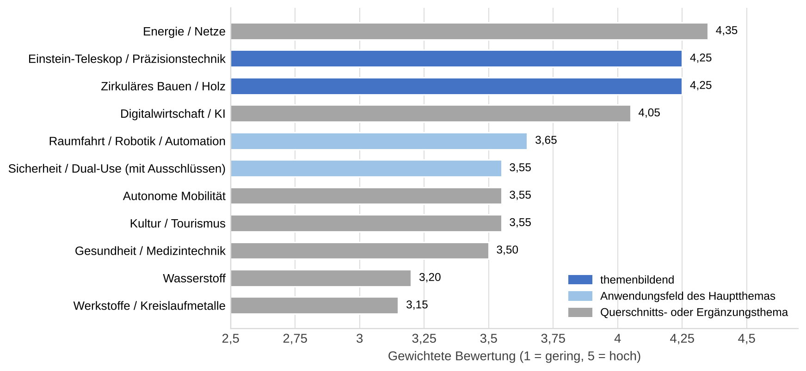
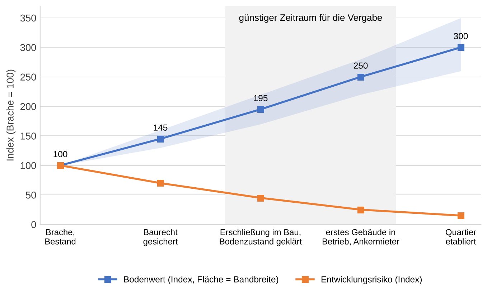
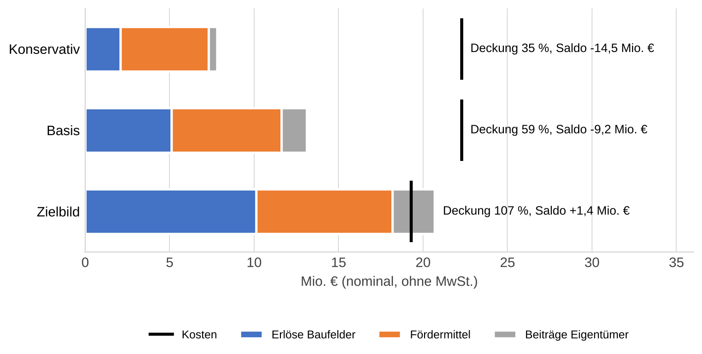
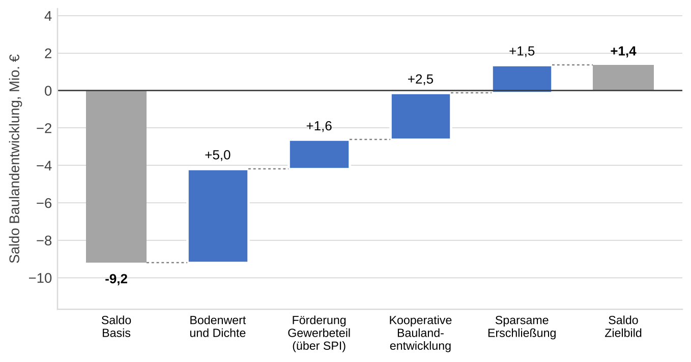
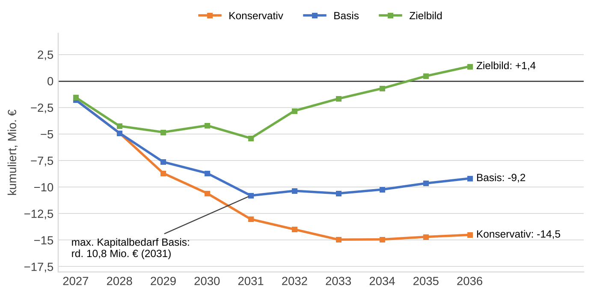
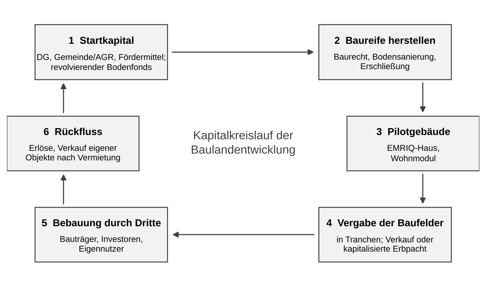

# EMRIQ Kelmis – Endbericht

:::toc

# Zusammenfassung

Die Deutschsprachige Gemeinschaft Belgiens (DG) beabsichtigt, in der Gemeinde Kelmis ein erstes Euregio Maas-Rhein Innovations-Quartier (EMRIQ) zu entwickeln. Das Quartier soll Forschung, Arbeit, Fertigung und Wohnen an einem Ort verbinden. Es soll thematisch klar ausgerichtet und in den Ort eingebunden sein und die Zusammenarbeit zwischen belgischen, deutschen und niederländischen Partnern stärken. Der vorliegende Bericht bündelt Standortanalyse, Marktanalyse und Branchenclusteranalyse und leitet daraus Empfehlungen für Themenprofil, Quartiersentwicklung, Entwicklungsmodell und Umsetzung ab.

Kelmis ist heute in erster Linie Wohnstandort. Rund 11.350 Einwohnern stehen nur etwa 1.130 Arbeitnehmerstellen gegenüber, das sind rd. 0,10 Stellen je Einwohner gegenüber rd. 0,28 im Durchschnitt der DG. Ein großer Teil der Erwerbstätigen pendelt nach Aachen. Die Lage zwischen den Hochschulstandorten Aachen, Lüttich und Maastricht ist ausgezeichnet, und das Kandidatengebiet für das Einstein-Teleskop grenzt unmittelbar an. Die Anbindung mit Bus und Bahn reicht jedoch für ein junges, hochschulnahes Publikum nicht aus: Der Bahnhof Hergenrath wird höchstens stündlich bedient, und die Buslinie nach Aachen benötigt rund 30 Minuten. Ein tragfähiges Mobilitätskonzept ist daher Voraussetzung für das Quartier.

Die Marktanalyse zeigt einen Bedarf, den der Standort bedienen kann. In Aachen fehlen kleine und flexible Büro-, Labor- und Hallenflächen bis etwa 1.000 m². Wohnen ist in Kelmis um 15 bis 25 % günstiger als in Aachen, und Belgien bietet steuerliche Anreize für forschende Unternehmen. Kelmis kann sich damit als Standort für wachsende Technologieunternehmen und Pilotfertigung positionieren, der die Angebote in Aachen und Herzogenrath ergänzt und Wohnen einschließt.

Für das Themenprofil wurden elf Branchencluster nach einheitlichen Kriterien bewertet. Empfohlen wird ein Profil für **Präzisions- und Resilienztechnologien**: hochgenaue Mess-, Sensor- und Photoniksysteme mit den Anwendungsfeldern Großforschung (Einstein-Teleskop), Raumfahrt und Schutz kritischer Infrastrukturen. Das Profil bleibt auch ohne Zuschlag für das Einstein-Teleskop tragfähig. Zirkulärer Holz-Hybridbau soll als Bauweise des Quartiers festgelegt werden, eine Energiegemeinschaft als Reallabor dienen. Damit erhalten die beiden prioritären Gewerbestandorte der DG unterschiedliche Profile: Kelmis für Präzisionstechnik und gemischtes Quartier, Kaiserbaracke für Holzwirtschaft und großflächiges Gewerbe.

Räumlich wird ein Kernquartier an der Lütticher Straße rund um das Museum Vieille Montagne empfohlen (Planbereich rd. 13 ha), ergänzt um einen zweiten Standort am Bahnhof Hergenrath und an der Hochheid für Mobilität und Werkstätten. Die erste Phase umfasst ein Technologie- und Gründerzentrum („EMRIQ-Haus“) mit 3.000 bis 4.800 m² Bruttogrundfläche sowie 40 bis 70 Wohneinheiten.

Für die Umsetzung wird ein Entwicklungsmodell vorgeschlagen, in dem die öffentliche Hand die Rolle des Flächenentwicklers übernimmt. DG und Gemeinde schaffen Baurecht, sanieren und erschließen die Flächen und vergeben die Baufelder in drei Tranchen parallel zur Erschließung, sobald der Wertzuwachs erkennbar und das Risiko für Erwerber gesunken ist. In der Anlaufphase errichtet der Initiator selbst Pilotgebäude, um die Nachfrage nachzuweisen und Investoren zu gewinnen. Nach der Musterrechnung decken Baufelderlöse, Fördermittel und Beiträge privater Eigentümer im Basisszenario rd. 59 % der Kosten der Baulandentwicklung von rd. 22 Mio. €. Eine vollständige Refinanzierung (rd. 107 %) ist erreichbar, wenn vier Hebel zusammenwirken: höhere Bodenwerte und Dichte, Förderung des gewerblichen Teils über die SPI, kooperative Baulandentwicklung mit den Eigentümern und eine sparsame Erschließung.

Die Gemeinde Kelmis kann aufgrund ihrer Haushaltslage keine zusätzlichen Folgekosten tragen. Da es in Belgien keine kommunale Gewerbesteuer gibt, gleicht erst der Wohnanteil die Folgekosten der Infrastruktur aus. Der Betrieb des Technologiezentrums benötigt in der Anlaufphase einen Zuschuss der DG oder der WFG.

Zeitnah bieten sich mehrere Anknüpfungspunkte: die Ausstellung des Projekts OBL'EU im Museum Vieille Montagne im November 2026, die Frist des Interreg-Aufrufs 8 am 16.12.2026, der Redaktionsschluss für die Bewerbungsunterlagen zum Einstein-Teleskop im Dezember 2026 und die Programmierung der EU-Strukturfonds 2028–2034 im Jahr 2027.

Tab: Eckdaten im Überblick
| Merkmal | Wert |
|---|---|
| Einwohner Kelmis (01.01.2024) | rd. 11.350 |
| Arbeitnehmerstellen in Kelmis | rd. 1.130 |
| Planbereich Kernquartier Lütticher Straße | rd. 13 ha |
| Programm Phase 1 | 3.000–4.800 m² BGF Gewerbe, 40–70 Wohneinheiten |
| Investition Phase 1 (Musterrechnung) | 38–48 Mio. € netto |
| Kosten Baulandentwicklung (Basisszenario) | rd. 22 Mio. € |
| Deckungsgrad Basisszenario / Zielbild | 59 % / 107 % |
| Maximaler Kapitalbedarf Bodenfonds (Basisszenario) | rd. 11 Mio. € |

Quelle: eigene Berechnungen auf Grundlage der Teilberichte 01–06

Aus der Untersuchung ergeben sich folgende Empfehlungen:

1. Themenprofil Präzisions- und Resilienztechnologien festlegen, ergänzt um Holz-Hybridbau als Bauweise und eine Energiegemeinschaft als Reallabor.
2. Kernquartier an der Lütticher Straße entwickeln und den Teilbereich Süd als gemischtes Quartier mit Wohnanteil sichern.
3. Mobilitätsangebot zwischen Bahnhof Hergenrath, Quartier und Aachen von Beginn an mitplanen.
4. Projektallianz aus DG, Gemeinde (AGR Kelmis) und WFG bilden, die SPI für den gewerblichen Teil einbinden und einen revolvierenden Bodenfonds einrichten.
5. Baufelder in Tranchen vergeben, Gewerbeflächen bevorzugt in kapitalisierter Erbpacht.
6. EMRIQ-Haus und ein erstes Wohnmodul als Pilotgebäude in öffentlicher Verantwortung errichten.
7. Das Vorhaben bereits 2026/2027 in die laufenden Förder- und Bewerbungsverfahren einbringen.

# Anlass, Aufgabenstellung und Vorgehen

## Anlass

Seit dem 1. Januar 2020 ist die Deutschsprachige Gemeinschaft für Raumordnung, Wohnungswesen und Teile der Energiepolitik zuständig. Auf dieser Grundlage wurden das Fachgutachten zur Raumstrategie, die Gewerbeflächenstrategie Ostbelgien und das Leitbild „Ostbelgien leben 2040“ erarbeitet. Die Gewerbeflächenstrategie benennt Kelmis und Kaiserbaracke als prioritäre Standorte und enthält für Kelmis ein Musterprojekt an der Lütticher Straße. Parallel hat das Interreg-Projekt OBL'EU gemeinsam mit der RWTH Aachen und Parkstad Limburg Schlüsselprojekte für einen grenzüberschreitenden Innovationsraum entwickelt.

Vor diesem Hintergrund strebt die DG ein erstes Euregio Maas-Rhein Innovations-Quartier in Kelmis an. Begründet wird die Standortwahl mit der Lage zwischen den Universitätsstandorten Aachen, Lüttich und Maastricht, mit der Anbindung über den Bahnhof Hergenrath und die Buslinien nach Aachen sowie mit der Geschichte des Ortes als ehemaliges Neutral-Moresnet. Hinzu kommt die Nähe zum Kandidatengebiet für das Einstein-Teleskop.

## Aufgabenstellung

Gefordert ist ein städtebauliches Entwicklungskonzept mit Umsetzungsplan einschließlich Wirtschaftlichkeitsbetrachtung. Aus dem Lastenheft ergeben sich folgende Anforderungen:

- Das Quartier soll thematisch klar ausgerichtet sein; eine Campusstrategie mit vielen Themen ist ausdrücklich nicht gewünscht.
- Arbeit, Forschung, Unternehmensgründung und Wohnen sollen zu einem Quartier mit Lebensqualität verbunden werden. Lokale Unternehmen und Akteure sind einzubinden, ein vom Ort entkoppelter Standort ist zu vermeiden.
- Der Umsetzungsplan muss Kostenschätzungen je Maßnahme und Phase enthalten, getrennt nach Infrastruktur und Gebäuden, sowie Folgekosten und Einnahmen der öffentlichen Hand.
- Der Strukturplan soll Geschossigkeit, Höhen, Dachformen, Abstände, Verkehrswege, Mobilitätskonzept und öffentlichen Raum darstellen und GIS-fähig im belgischen Lambert-System vorliegen.
- Die Ergebnisse sind in Deutsch, Französisch und Englisch in einer Form aufzubereiten, die sich zur Vermarktung des Standorts eignet.

## Grundlagen

Tab: Ausgewertete Grundlagen
| Grundlage | Relevante Inhalte |
|---|---|
| Gewerbeflächenstrategie Ostbelgien (HJPplan+, 2024) | Musterprojekt Kelmis Lütticher Straße (132.511 m²) mit Bestandsanalyse, Strukturkonzepten und Rahmenplan; Technologie- und Gründerzentrum gegenüber dem Museum; AGR Kelmis als möglicher Träger |
| Projekt OBL'EU (MDG, RWTH Aachen, Parkstad Limburg, 2025–2026) | Schlüsselprojekte u. a. Scale-up Innovation Center, Digital Hub Ostbelgien, Radschnellweg Eupen–Aachen mit Abzweig Hergenrath, HOLZ+ Reallabor, Erbpachtmodelle; Abschlussausstellung im Museum Vieille Montagne im November 2026 |
| Leitbild „Ostbelgien leben 2040“ (MDG, 2024) | Leitziele nachhaltige Wirtschafts- und Arbeitsregion, Viertelstunden-Region, resiliente Siedlungsentwicklung; Raumbild KOMMpaktLAND |
| Lastenheft und Forum zum Verfahren FbRAUM.KaR/39.02-01/26.128 | Leistungsbild, Anforderungen an Wirtschaftlichkeitsbetrachtung und Strukturplan |

Quelle: eigene Zusammenstellung

## Vorgehen

Die Untersuchung beruht auf der Auswertung der vorliegenden Planungen und Studien sowie auf öffentlich zugänglichen Statistiken, Marktberichten und Rechtsgrundlagen aus Belgien, Deutschland und den Niederlanden. Eigene Primärerhebungen wurden nicht durchgeführt. Der Standort wurde anhand von sieben Kriterien in vier Teilräumen bewertet. Für die Branchenclusteranalyse wurde eine gewichtete Bewertungsmatrix verwendet, die für alle Cluster gleich angewendet wurde. Kosten, Erlöse und Finanzierung wurden in Musterrechnungen mit Szenarien abgeschätzt. Alle Mengen- und Wertangaben dieser Musterrechnungen sind Annahmen und im weiteren Verfahren baufeldgenau zu überprüfen.

# Standortanalyse

## Lage und Erreichbarkeit

Kelmis liegt im Dreiländereck rund 8 km von Aachen entfernt. Die RWTH Aachen und das Universitätsklinikum sind mit dem Pkw in 15 bis 20 Minuten erreichbar, Lüttich, Maastricht und Heerlen liegen im Pendelbereich. Die wallonischen Probebohrungen für das Einstein-Teleskop wurden 2024 in den Nachbargemeinden Plombières, Welkenraedt und Aubel durchgeführt. Der Güterbahnhof Montzen ist als Logistikstandort für das Vorhaben vorgesehen.

Die Erreichbarkeit mit öffentlichen Verkehrsmitteln ist der wesentliche Engpass. Der Bahnhof Hergenrath wird nur von der Regionalverbindung Aachen–Welkenraedt–Lüttich bedient, höchstens im Stundentakt und in der Vergangenheit mit Ausfällen. Der grenzüberschreitende Dreiländerzug hält dort nicht. Die Buslinie 24 verbindet Kelmis in rund 30 Minuten mit Aachen. An der Grenze wechselt das Tarifsystem, und es ist zu klären, ob Deutschlandticket und Semesterticket auf belgischer Seite gelten. Die Autobahn A3/E40 ist in 5 bis 9 km erreichbar. Ein Radschnellweg Eupen–Aachen mit Abzweig nach Hergenrath soll bis 2028 konzipiert und bis 2035 gebaut werden.

## Bevölkerung und Arbeitsplätze

Kelmis hatte am 1. Januar 2024 rund 11.350 Einwohner. Rund 39 % der Bevölkerung besitzen nicht die belgische Staatsangehörigkeit, überwiegend handelt es sich um Deutsche. Ursache ist vor allem die Wanderung über die Grenze: Viele Haushalte wohnen in Kelmis und arbeiten in Aachen.

Mit 154 Arbeitgebern und rund 1.130 Arbeitnehmerstellen ist die Arbeitsplatzdichte gering. Kelmis ist damit ein Wohnort mit hohem Auspendleranteil. Für das Quartier bedeutet das, dass qualifizierte Fachkräfte bereits vor Ort leben, aber überwiegend außerhalb der Gemeinde arbeiten.

## Geschichte und Identität

Zwischen 1816 und 1920 war das Gebiet um Kelmis als Neutral-Moresnet ein eigenständiges Territorium zwischen Preußen und den Niederlanden bzw. Belgien. Die Zinkhütte der Vieille Montagne, ein Vorläufer des heutigen Unternehmens Umicore, prägte den Ort mit einem eigenen Sozialsystem. Anfang des 20. Jahrhunderts gab es Bestrebungen, hier einen Esperanto-Staat („Amikejo“) zu gründen. Diese Geschichte verbindet die Themen Werkstoffe, Grenzüberschreitung und Verständigung und bietet einen glaubwürdigen Anknüpfungspunkt für ein grenzüberschreitendes Innovationsquartier. Mit dem Museum Vieille Montagne verfügt der Standort zudem über einen bekannten öffentlichen Ort, an dem das Quartier seine Adresse ausbilden kann.

## Umweltbelange und Restriktionen

Die Entwicklung wird durch mehrere Faktoren eingeschränkt, die Kosten und Zeitplan beeinflussen:

- Böden mit Schwermetallbelastung und Altbergbau aus dem Zinkerzabbau
- Natura-2000-Gebiete mit Galmeirasen im Göhltal sowie das Schutzgebiet am Casinoweiher
- Hochwassergefahr an der Göhl (Ereignis 2021)
- Trinkwasserfassung „Casino“

Nach dem wallonischen Bodendekret ist vor jedem Verkauf ein Auszug aus der Bodenstandsbank vorzulegen; bei Verdachtsflächen ist im Genehmigungsverfahren eine Orientierungsstudie erforderlich. Es wird empfohlen, in der ersten Projektphase ein Boden- und Baugrundscreening für alle Teilflächen durchzuführen.

## Planungsrechtliche Situation

Der nördliche Teil des Planbereichs an der Lütticher Straße ist im Sektorenplan als gemischtes Gewerbegebiet ausgewiesen, der südliche Teil als Wohngebiet, wird aber überwiegend gewerblich genutzt. Die Gewerbeflächenstrategie regt an, den südlichen Teil als Gewerbegebiet auszuweisen. Für ein Quartier mit Wohnanteil wäre dies nachteilig, weil Wohnen im Gewerbegebiet grundsätzlich ausgeschlossen ist. Das Wohngebiet lässt dagegen nicht störende Forschung, Dienstleistung und Handwerk zu. Es wird daher empfohlen, den südlichen Teil als gemischtes Quartier zu entwickeln. Die Reform des Gesetzbuchs über die räumliche Entwicklung (Dok. 146) befand sich im Juni 2026 im parlamentarischen Verfahren; ihr Stand und ihre Instrumente sind zu prüfen.

## Bewertung der Teilräume

Vier Teilräume wurden nach sieben Kriterien auf einer Skala von 1 (ungünstig) bis 5 (günstig) bewertet.

Tab: Bewertung der Teilräume
| Kriterium | A Nord | B Süd | C Hergenrath | D Heimbach |
|---|---|---|---|---|
| Erreichbarkeit mit Bus und Bahn | 3 | 3 | 5 | 2 |
| Flächengröße | 5 | 4 | 2 | 4 |
| Verfügbarkeit, Eigentum | 2 | 3 | 2 | 1 |
| Restriktionen (5 = gering) | 3 | 3 | 3 | 2 |
| Einbindung in den Ort | 4 | 5 | 3 | 3 |
| Adressbildung, Sichtbarkeit | 5 | 4 | 3 | 3 |
| Wohnanteil möglich | 2 | 5 | 3 | 2 |
| **Summe (max. 35)** | **24** | **27** | **21** | **17** |

Quelle: eigene Bewertung. A = Lütticher Straße Nord (Nr. 257, Busbetriebshof, Bauhof); B = Lütticher Straße Süd; C = Bahnhof Hergenrath und Hochheid; D = Lütticher Straße 63 (Heimbach)

Der südliche Teil der Lütticher Straße erreicht die höchste Bewertung, gefolgt vom nördlichen Teil. Beide zusammen bilden mit rund 13 ha den größten zusammenhängenden Raum mit guter Adresse und Anbindung an den Ort. Der Bahnhof Hergenrath ist am besten erreichbar, bietet aber zu wenig Fläche für ein vollständiges Quartier. Das Betriebsgelände von Heimbach ist genutzt und kommt als Entwicklungsfläche nicht in Betracht; das Unternehmen sollte jedoch als Partner eingebunden werden.

Empfohlen wird daher eine Entwicklung an zwei Standorten. Das Kernquartier an der Lütticher Straße umfasst im Norden das EMRIQ-Haus gegenüber dem Museum, die Nachverdichtung des Bauhofs und später das Gelände des Busbetriebshofs. Im Süden entsteht ein gemischtes Quartier mit Wohnungen, Werkstätten, einem Quartiersplatz und einer Kindertagesstätte. Am Bahnhof Hergenrath und an der Hochheid entstehen ein Mobilitätsknoten, ein kleines Co-Working-Angebot und eine Werkstatt- und Automationseinheit, für die das dort ansässige Unternehmen HAHN Automation als Partner in Frage kommt. Beide Standorte werden über eine rund 3 bis 4 km lange Achse mit Shuttle- oder Rufbusverkehr und einer Radverbindung verknüpft.

## Stärken und Schwächen

Tab: Stärken-Schwächen-Analyse
| Stärken | Schwächen |
|---|---|
| Lage zwischen drei Hochschulstandorten; Geschichte von Neutral-Moresnet; Museum als Adresse; untergenutzte Flächen im Ortskern; Mehrsprachigkeit; günstiges Wohnen; kurze Wege zwischen Gemeinde und DG | geringe Arbeitsplatzdichte, kein Innovationsprofil; Takt und Tarifgrenze im öffentlichen Verkehr; Altlasten, Natur- und Hochwasserrestriktionen; kleinteiliges Eigentum; Busbetriebshof als Fehlnutzung |
| **Chancen** | **Risiken** |
| Flächenknappheit in Aachen; Einstein-Teleskop; steigende EU-Mittel für Resilienz und Sicherheit; belgische Steueranreize; Projekte aus OBL'EU; Radschnellweg | Zuschlag des Einstein-Teleskops an einen anderen Standort; Konkurrenz durch etablierte Technologieparks; Akzeptanz in der Bevölkerung; Wechsel der politischen Mehrheiten; Finanzierungslücke bei Laborbauten |

Quelle: eigene Darstellung

# Marktanalyse

## Wohnungsmarkt

Die Angebotsmieten liegen in Aachen bei 11,40 bis 11,90 €/m², in Kelmis nach Einzelangeboten bei 9 bis 10 €/m². Einfamilienhäuser wurden in Kelmis 2025 überwiegend zu Preisen zwischen 180.000 und 255.000 € gehandelt. Beim Erwerb der eigenen, einzigen Wohnung fallen in der Wallonie seit 2025 3 % Registrierungsgebühren an, in Nordrhein-Westfalen 6,5 % Grunderwerbsteuer. Das Preisgefälle begünstigt den Zuzug aus Deutschland, ist aber nicht so groß, dass es allein Nachfrage erzeugt.

Für das Quartier sind vor allem kleine, möblierte und flexibel nutzbare Wohnungen relevant, etwa Apartments mit Serviceleistungen und gemeinschaftliche Wohnformen, außerdem Mietwohnungen in guter Qualität. Zielgruppen sind Doktorandinnen und Doktoranden, Berufseinsteiger, Gründer und Forschende aus dem Ausland. Familienwohnungen werden mit dem Betrieb des Einstein-Teleskops wichtiger, falls der Zuschlag in die Euregio geht.

## Büro-, Labor- und Gewerbeflächen

In Aachen besteht nach Angaben der Initiative Aachen ein Mangel an kleinen und flexiblen Büro-, Werkstatt- und Produktionsflächen bis etwa 1.000 m². Die Büromieten reichen in Aachen von 6,50 bis 22 €/m², in Herzogenrath von unter 6,50 bis 10 €/m². Der Brightlands Maastricht Health Campus ist zu rund 95 % belegt. Technologieorientierte Unternehmen in der Wachstumsphase benötigen typischerweise 300 bis 1.500 m² gemischte Flächen aus Büro, Labor und Halle, häufig mit Werkstatthöhen von 6 bis 8 m und schwingungsarmen Laborräumen.

Daraus ergibt sich eine Positionierung, die die bestehenden Angebote ergänzt. Der RWTH Aachen Campus ist auf Forschung und Industriekooperation ausgerichtet, der Technologiepark Herzogenrath auf Gründungen. Kelmis kann Flächen für die anschließende Wachstumsphase, für Pilotfertigung und für den Markteintritt in Belgien und Frankreich anbieten, verbunden mit Wohnungen im Quartier.

## Wettbewerbsstandorte

Tab: Wettbewerbsstandorte in der Euregio
| Standort | Profil | Stärke | Nachteil gegenüber Kelmis |
|---|---|---|---|
| RWTH Aachen Campus | Forschungscluster, Industriepartner | Nähe zur Forschung, Bekanntheit | knappe und teure Flächen, kaum Wohnen |
| Technologiepark Herzogenrath | Gründer- und Technologiezentrum seit 1989 | Erfahrung, Netzwerk | Bestandsgebäude, kein Wohnen |
| Avantis (Aachen/Heerlen) | grenzüberschreitender Gewerbepark | Flächenangebot, Grenzlage | langsame Vermarktung, heute überwiegend Logistik |
| Brightlands (Maastricht, Heerlen, Sittard) | Life Sciences, Digitalwirtschaft, Chemie | Ökosystem, Kapital | andere Themen, hohe Auslastung |
| Liège Science Park | Biotechnologie, Raumfahrt, Ingenieurwesen | Größe, ULiège | französischsprachig, Entfernung zu Aachen |
| Kaiserbaracke, Eupen | klassische Gewerbegebiete | Fläche, Autobahnanschluss | kein Innovationsprofil, keine Bahnverbindung nach Aachen |

Quelle: eigene Darstellung nach Teilbericht 02

Das Beispiel Avantis zeigt, dass eine zu enge Branchenvorgabe die Vermarktung eines grenzüberschreitenden Parks bremsen kann. Das Themenprofil des EMRIQ sollte deshalb als Leitlinie für die Vergabe dienen und nicht als ausschließliche Nutzungsbeschränkung.

## Einstein-Teleskop

Die Baukosten des Einstein-Teleskops werden mit rund 2,3 Mrd. € angegeben, wovon etwa ein Drittel auf das Vakuumsystem entfällt. Erwartet werden rund 500 direkte und 1.150 indirekte Arbeitsplätze. Die Standortentscheidung ist für die zweite Jahreshälfte 2027 vorgesehen; der Bau könnte etwa 2028 beginnen, der Betrieb um 2035. Neben der Euregio Maas-Rhein bewerben sich Sardinien und die Lausitz gemeinsam. Für Kelmis wäre in drei Stufen mit Nachfrage zu rechnen: zunächst durch Projektbüros (2026–2028), dann durch Zulieferer und Personal in der Bauphase (2028–2035) und schließlich durch Forschende mit ihren Familien. Das Konzept muss jedoch auch ohne Zuschlag tragfähig sein. Das Einstein-Teleskop wird daher als zusätzliche Chance behandelt, nicht als Voraussetzung.

## Nachfrage und Raumprogramm

Tab: Raumprogramm nach Phasen (Schätzung)
| | Phase 1 | Phase 2 | Phase 3 (Option) |
|---|---|---|---|
| Zeitraum | Bau 2029–2031 | 2032–2036, Gelände Busbetriebshof | ab 2036, abhängig vom Einstein-Teleskop |
| Bruttogrundfläche Gewerbe | 3.100–4.800 m² | 5.500–8.800 m² | 8.500–16.000 m² |
| Wohneinheiten | 40–70 | 80–150 | 150–300 |
| Arbeitsplätze | 80–150 | 150–300 | 250–500 |

Quelle: eigene Schätzung

Für die Vermarktung gewerblicher Flächen wurden drei Annahmen getroffen. Bei vorsichtiger Betrachtung ist mit 300 bis 500 m² im Jahr zu rechnen. Im Basisfall sind es 600 bis 1.000 m², wenn ein Ankermieter gewonnen wird und Kooperationen mit RWTH, Technologiepark Herzogenrath und WFG bestehen. Mit einem Zuschlag für das Einstein-Teleskop sind 1.500 bis 2.500 m² im Jahr möglich. Der Technologiepark Herzogenrath ist seit 1989 durchschnittlich um rund 700 m² im Jahr gewachsen.

## Zielgruppen

Tab: Zielgruppen und Anforderungen
| Zielgruppe | Flächenbedarf | Wohnbedarf | Priorität |
|---|---|---|---|
| Gründer aus RWTH, FH Aachen, ULiège, Universität Maastricht | 20–150 m², Co-Working, gemeinsames Labor | Apartment, gemeinschaftliches Wohnen | hoch |
| Wachsende Technologieunternehmen (10–60 Beschäftigte) | 300–1.500 m² Büro, Labor, Halle | Mietwohnungen, Apartments | hoch |
| Unternehmen aus der DG mit Innovationsprojekten | 50–300 m² Projektbüro oder Labor | vor Ort ansässig | hoch |
| Forschungseinrichtungen, Projektbüros (z. B. Einstein-Teleskop) | 200–1.000 m², Prüfstände | Gästewohnungen | mittel bis hoch |
| Niederlassungen größerer Unternehmen (Photonik, Raumfahrt, Sicherheitstechnik) | 500–3.000 m² | Firmenwohnungen | mittel |
| Fachkräfte und Forschende aus dem Ausland | – | Familienwohnungen, möblierte Wohnungen | mittel |

Quelle: eigene Darstellung

# Branchenclusteranalyse

## Methodik

Elf Branchencluster wurden mit derselben gewichteten Matrix bewertet. Vorab wurde geprüft, ob ein Cluster themenbildend ist, also Unternehmen gezielt an den Standort zieht, oder ob es sich um eine Querschnittsfunktion handelt, die jedes Quartier benötigt.

Tab: Bewertungskriterien und Gewichtung
| Kriterium | Gewicht |
|---|---|
| Regionale Kompetenzbasis | 20 % |
| Markt- und Fördermitteldynamik | 20 % |
| Grenzüberschreitender Mehrwert | 15 % |
| Städtebauliche Verträglichkeit im Ort | 15 % |
| Flächen- und Investitionsbedarf in Kelmis | 10 % |
| Bezug zum Standort, Alleinstellung | 10 % |
| Akzeptanz, Risiko | 10 % |

Quelle: eigene Darstellung

## Ergebnisse

{15}

Quelle: eigene Bewertung, Teilberichte 03a und 03b

Tab: Bewertungsergebnis und vorgeschlagene Rolle der Cluster
| Cluster | Punkte | Vorgeschlagene Rolle |
|---|---|---|
| Einstein-Teleskop, Präzisionstechnik | 4,25 | Hauptthema; ohne Zuschlag für das Einstein-Teleskop 3,80 |
| Zirkuläres Bauen, Holz | 4,25 | verbindliche Bauweise des Quartiers; Alternative als Hauptthema |
| Energie, Netze | 4,35 | Reallabor „Energiegemeinschaft“ für das Quartier |
| Digitalwirtschaft, KI | 4,05 | Querschnittsthema: Co-Working, digitales Modell des Quartiers |
| Raumfahrt, Robotik, Automation | 3,65 | Anwendungsfeld des Hauptthemas; Automationslabor an der Hochheid |
| Sicherheit, Dual-Use | 3,55 | ziviles Anwendungsfeld mit festen Ausschlüssen |
| Autonome Mobilität | 3,55 | Pilotverkehr zwischen Bahnhof Hergenrath und Museum |
| Kultur, Tourismus | 3,55 | Identität und Lebensqualität (Museum, Neutral-Moresnet) |
| Gesundheit, Medizintechnik | 3,50 | ergänzendes Wohnangebot für ältere Menschen |
| Wasserstoff | 3,20 | Netzwerkthema ohne Standortbezug |
| Werkstoffe, Kreislaufmetalle | 3,15 | historischer Bezug (Zink, Umicore), kleines Werkstofflabor |

Quelle: eigene Bewertung

Energie und Netze erzielen zwar die höchste Punktzahl, beschreiben aber eine Funktion, die jedes Quartier braucht; Unternehmen siedeln sich deswegen nicht gezielt in Kelmis an. Als themenbildend kommen Präzisionstechnik und zirkuläres Bauen in Betracht, die gleichauf liegen.

## Empfohlenes Themenprofil

Empfohlen wird das Themenprofil **Präzisions- und Resilienztechnologien** (Arbeitstitel). Den Kern bilden hochgenaue Mess-, Sensor- und Photoniksysteme mit den Schlüsseltechnologien Laser und Optik, Vakuum- und Kryotechnik, Schwingungsisolation, Präzisionsmontage und Datenauswertung. Anwendungsfelder sind die Großforschung mit dem Einstein-Teleskop, Raumfahrt und Erdbeobachtung sowie der Schutz kritischer Infrastrukturen und der Katastrophenschutz.

Für dieses Profil sprechen vier Gründe. Es entspricht den Zielen des Lastenhefts, das auf europäische Industriestandorte, Sicherheit und das Einstein-Teleskop Bezug nimmt. Es erzeugt mehr Arbeitsplätze und Wertschöpfung je Quadratmeter als der Holzbau. Mit dem Fraunhofer ILT und der RWTH bestehen enge Bezüge nach Aachen, mit HAHN Automation gibt es einen Partner vor Ort. Schließlich ergänzt es die Ausrichtung des Standorts Kaiserbaracke auf die Holzwirtschaft, statt mit ihm zu konkurrieren.

Sollte die DG ein Profil bevorzugen, das stärker auf vorhandene regionale Betriebe aufbaut, oder geht der Zuschlag für das Einstein-Teleskop 2027 nicht in die Euregio, bietet sich als Alternative ein Quartier für zirkuläres Bauen und Energie an.

## Umgang mit Sicherheits- und Verteidigungsthemen

Die Mittel für Sicherheit und Verteidigung steigen auf europäischer, belgischer und wallonischer Ebene deutlich. Belgien erhält aus dem Programm SAFE vorläufig 8,34 Mrd. €, und die Wallonie hat im Juni 2026 eine eigene Verteidigungsstrategie beschlossen. Zugleich ist das Thema in einer Wohngemeinde und vor dem Hintergrund der Geschichte von Neutral-Moresnet sensibel. Es wird empfohlen, das Quartier zivil zu führen und Anwendungen mit doppeltem Verwendungszweck nur in den Bereichen Sensorik, Software, Werkstoffe und Präzisionstechnik zuzulassen. Waffen, Munition und Explosivstoffe sollten ausdrücklich ausgeschlossen werden. Diese Regeln sollten in Erbpacht- und Mietverträgen verankert und durch einen Quartiersbeirat mit Beteiligung der Bevölkerung begleitet werden.

# Strategische Quartiersentwicklung

## Leitbild

Auf dem Boden des früheren Neutral-Moresnet entsteht ein Quartier, in dem Forschende, Gründer und Unternehmen aus Belgien, Deutschland und den Niederlanden an Präzisionstechnologien für Wissenschaft, Raumfahrt und den Schutz kritischer Infrastrukturen arbeiten und in der Nähe ihres Arbeitsplatzes wohnen. Museum, Seen und Göhltal prägen das Umfeld, Aachen ist in wenigen Minuten erreichbar.

## Handlungsansätze

Die folgenden Handlungsansätze ergänzen das Themenprofil um die Elemente, die ein Quartier von einem Gewerbegebiet unterscheiden. Sie sind zugleich Voraussetzung dafür, dass Investoren und Projektentwickler das Vorhaben als marktfähig einschätzen (vgl. Kapitel 7).

### Aktivierung und Ankernutzer

Das Quartier sollte bereits sichtbar werden, bevor neu gebaut wird. Ab 2027 kann in einem leerstehenden Gebäude an der Lütticher Straße oder im Museum ein vorläufiges Angebot mit Co-Working und Werkstattlabor eingerichtet werden. Veranstaltungen und Sommerschulen mit RWTH, ULiège und Fraunhofer schaffen Kontakte und geben Hinweise auf die tatsächliche Nachfrage. Die Ausstellung des Projekts OBL'EU im November 2026 eignet sich als Auftakt.

Vor dem Baubeschluss sollten Absichtserklärungen von Ankernutzern aus drei Bereichen vorliegen:

- Forschung: Außenstelle eines Fraunhofer- oder RWTH-Instituts, Projektbüro für das Einstein-Teleskop
- Unternehmen: HAHN Automation, Heimbach, Niederlassung eines Photonik- oder Raumfahrtunternehmens
- Alltag: Museum, Kindertagesstätte, Gastronomie

Ein Ansiedlungsservice kann deutsche und niederländische Unternehmen unterstützen, die über Kelmis den belgischen und französischsprachigen Markt erschließen wollen. Dazu gehören Hilfe bei der Gründung einer belgischen Gesellschaft, Beratung zu Innovationsabzug und Lohnsteuerbefreiung für Forschende sowie Fördermittelberatung, jeweils in deutscher Sprache. Bestehende Betriebe sollten als Partner gewonnen werden. Für den Busbetriebshof und den Baustoffhandel sind einvernehmliche Verlagerungen anzustreben, etwa in ein Depot für Elektrobusse am Ortsrand oder in einen Gewerbehof.

### Fachkräfte und Wohnen

Viele Einwohner von Kelmis pendeln täglich nach Aachen. Ein Co-Working-Angebot im EMRIQ-Haus und Büros Aachener Unternehmen im Quartier können einen Teil dieser Arbeitswege verkürzen. Die steuer- und sozialversicherungsrechtlichen Grenzen der Telearbeit für Grenzpendler sind dabei zu beachten; der GrenzInfoPunkt Aachen-Eurode kann hierzu beraten.

Das Wohnangebot sollte ab der ersten Phase möblierte Apartments, gemeinschaftliche Wohnformen und Gästewohnungen umfassen, ab der zweiten Phase auch Familienwohnungen. Für Ankerunternehmen können Belegungsrechte vereinbart werden. Ein Willkommensservice, eine Kindertagesstätte und die Zusammenarbeit mit internationalen Schulen in Aachen erleichtern die Gewinnung von Fachkräften. Damit das Quartier auch der Bevölkerung von Kelmis nützt, sollten ein Schülerlabor, ein Ausbildungslabor mit HAHN Automation und dem ZAWM sowie öffentlich nutzbare Freiräume vorgesehen werden.

### Produkt und Bauweise

Statt die Zahl der Stellplätze am bisherigen Bedarf auszurichten, sollte Mobilität als Dienstleistung angeboten werden: ein Mobilitätsabonnement mit Nahverkehr, Shuttle zum Bahnhof Hergenrath, Leihrädern und Carsharing. Die Stellplätze werden in einer Quartiersgarage gebündelt, der Stellplatzschlüssel kann auf 0,5 bis 0,7 je Wohnung sinken. Jeder nicht gebaute Tiefgaragenstellplatz spart rund 20.000 bis 30.000 € und verbessert die Wirtschaftlichkeit der Baufelder. Eine Energiegemeinschaft mit Photovoltaik auf den Hallendächern, Wärmenetz und Speicher senkt die Nebenkosten und verbessert die Bewertung des Quartiers nach Nachhaltigkeitskriterien.

Serieller Holz-Hybridbau verkürzt die Bauzeit, verbessert die CO₂-Bilanz und stärkt die regionale Holzwirtschaft. Die Baufelder sollten so zugeschnitten werden, dass Gebäude später anders genutzt werden können: mit Nutzungsspielräumen zwischen Wohnen, Büro und Labor, Konstruktionsrastern von 7,5 bis 8,1 m und Geschosshöhen von 3,5 bis 4,2 m in den unteren Geschossen. Diese Flexibilität erhöht den Wert der Gebäude für spätere Käufer.

### Steuerung und Zusammenarbeit

Die Grundstücke sollten im Wege der Konzeptvergabe vergeben werden. Ein Gestaltungsleitfaden und Baufeldpässe in drei Sprachen beschreiben Nutzung, Kubatur, Freiraum- und Energiestandard. Ein Orientierungsschema mit vorab abgestimmten Baufeldern ermöglicht kurze Genehmigungszeiten; eine gemeinsame Anlaufstelle von Fachbereich Raumordnung der DG, Gemeinde und WFG erleichtert die Abstimmung. Ein Beirat mit Vertretern aus Aachen (StädteRegion, RWTH, AGIT), Lüttich (Noshaq, ULiège) und Limburg (LIOF, Brightlands) verankert das Quartier in der Euregio. Flächen für eine dritte Phase sollten bis zur Entscheidung über das Einstein-Teleskop freigehalten und bis dahin zwischengenutzt werden.

## Schlüsselprojekte

Tab: Schlüsselprojekte
| Projekt | Standort, Phase | Inhalt |
|---|---|---|
| EMRIQ-Haus | gegenüber dem Museum, Phase 1 | Technologie- und Gründerzentrum mit drei bis vier Geschossen in Holz-Hybridbauweise; im Erdgeschoss Co-Working, Gastronomie und Veranstaltungsfläche, darüber Büros von 20 bis 200 m² und schwingungsarme Labore, rückwärtig teilbare Hallen |
| Informations- und Kontaktstelle Einstein-Teleskop | Museum Vieille Montagne, ab 2027 | Ausstellung, Kontaktvermittlung für Zulieferer, Willkommensservice; Museum als Mieter |
| Automationslabor | Hochheid, Phase 1–2 | Integrations- und Ausbildungslabor für automatisierte Präzisionsmontage mit HAHN Automation, FH Aachen und ZAWM |
| Labor für Sensorik und Infrastrukturschutz | Phase 2 | Sensorik, Erdbeobachtung, Schutz von Netzen und Wasserversorgung; zivil geführt |
| Wohnen für Forschende und Gründer | Lütticher Straße Süd, Phase 1–2 | Apartments, Gästewohnungen und Familienwohnungen in Holzbauweise |
| Energiegemeinschaft | gesamter Planbereich | Photovoltaik, Wärmenetz, Speicher; Reallabor mit Forschungspartnern |
| Verbindung Hergenrath–Museum | öffentlicher Raum | Mobilitätsknoten am Bahnhof, Shuttle oder Rufbus, Anschluss an den Radschnellweg |

Quelle: eigene Darstellung

## Städtebauliche Grundsätze

Die Entwicklung folgt dem Grundsatz der Innenentwicklung. Durch Nachverdichtung und Stapelung von Nutzungen soll die Geschossflächenzahl der Baufelder von heute rund 0,3 auf 1,0 bis 1,5 steigen; Geländesprünge können für die Erschließung oberer Geschosse genutzt werden. Die rückwärtigen Flächen werden über eine parallel zur Lütticher Straße verlaufende Erschließung angebunden. Am Museum entsteht die Adresse des Quartiers, ein Quartiersplatz verbindet es mit dem Ort. Regenwasser wird im Quartier zurückgehalten, versiegelte Flächen werden reduziert, und die Galmeiflora wird in die Freiraumgestaltung aufgenommen.

# Entwicklungsmodell und Kapitalmarktfähigkeit

## Grundprinzip

An einem Standort ohne Marktreferenzen sind private Projektentwickler in der Regel nicht bereit, Planungs-, Boden- und Vermarktungsrisiken zu übernehmen, oder sie preisen diese mit hohen Abschlägen ein. Es wird daher ein Modell vorgeschlagen, in dem die öffentliche Hand die Rolle des Flächenentwicklers übernimmt. DG und Gemeinde Kelmis entwickeln über die AGR, später über eine Entwicklungsgesellschaft und für den gewerblichen Teil gemeinsam mit der SPI, die Flächen bis zur Baureife. Sie schaffen Baurecht, sanieren die Böden, erschließen die Flächen und errichten die ersten Gebäude. Die Bebauung der übrigen Baufelder übernehmen Bauträger, Investoren und Unternehmen.

Das Modell erfüllt drei Aufgaben. Erstens werden die Risiken abgebaut, für die Investoren an einem neuen Standort hohe Abschläge verlangen würden. Zweitens fließt die Wertsteigerung der Grundstücke, die durch Baurecht, Erschließung und Quartiersqualität entsteht, über Verkaufserlöse, Erbpacht und Beiträge der Eigentümer an die öffentliche Hand zurück. Drittens werden die Erlöse über einen revolvierenden Bodenfonds für die nächste Phase eingesetzt.

## Prüfung des Ansatzes

Geprüft wurde der Ansatz, das Quartier bis zu Baurecht und Erschließung zu entwickeln, die Baufelder parallel zur Erschließung zum günstigsten Zeitpunkt zu vergeben und damit die Kosten für Infrastruktur und Baurecht zu refinanzieren. In der Anlaufphase soll der Initiator zudem eigene Gebäude errichten.

Der Ansatz ist für Kelmis geeignet, trägt sich aber nicht von selbst. Die Bodenwerte sind derzeit niedrig. Baugrundstücke kosteten in der Provinz Lüttich 2023 im Mittel 137 €/m²; für Kelmis werden 120 bis 190 €/m² angenommen. Im Wohnungsneubau liegen erzielbare Preise und Baukosten so nah beieinander, dass kaum ein Bodenwert verbleibt. Im Basisszenario decken die Baufelderlöse allein nur rd. 23 % der Kosten der Baulandentwicklung, zusammen mit Fördermitteln und Beiträgen der Eigentümer rd. 59 %. Ein Deckungsgrad von rd. 107 % wird erreicht, wenn die vier in Abschnitt 7.5 beschriebenen Maßnahmen zusammenwirken.

Für die eigenen Gebäude des Initiators gilt eine weitere Einschränkung. Ein Technologiezentrum müsste bei der derzeitigen Spitzenrendite für Büros in der Wallonie von 7,6 % eine Monatsmiete von rund 26 €/m² erzielen, um für einen privaten Investor wirtschaftlich zu sein. Marktüblich sind 6,50 bis 18 €/m². Ohne langfristigen Generalmietvertrag der WFG oder der DG und ohne Investitionszuschuss ist ein solches Gebäude nicht an Investoren zu veräußern. Wegen der geringen Marktgröße kommen als Erwerber in erster Linie regionale Bauträger, Projektentwickler aus Aachen und Lüttich, Unternehmen als Eigennutzer und halböffentliche Finanzierer in Betracht. Institutionelle Investoren werden erst für vermietete Bestände ab etwa 15 Mio. € in der zweiten Phase erreichbar sein.

## Wertentwicklung und Vermarktungszeitpunkt

{15}

Quelle: eigene Darstellung; Indexwerte sind typische Größenordnungen und im Projekt zu kalibrieren

Der Grundstückswert steigt mit jeder Entwicklungsstufe, weil jeweils ein Risiko entfällt. Der günstigste Zeitpunkt für die Vergabe der Baufelder („Sweet Spot“) liegt zwischen dem Beginn der Erschließung und der Inbetriebnahme des ersten Gebäudes. Zu diesem Zeitpunkt ist der Wertzuwachs aus Baurecht und Erschließung bereits eingetreten, das verbleibende Risiko ist für regionale Bauträger tragbar, und der Kapitaleinsatz des Initiators ist noch begrenzt, weil Erschließung und Vergabe parallel laufen. Mit der Belegung des EMRIQ-Hauses liegen zudem erste Marktdaten vor, die höhere Preise begründen.

Wird zu früh verkauft, verbleibt die Wertsteigerung aus der Planung bei den Erwerbern. Wird zu spät verkauft, bleibt Kapital über Jahre gebunden. Die Baufelder sollten daher in Tranchen vergeben werden; ein Teil der Flächen wird als Reserve zurückgehalten. Wohnbaufelder eignen sich für die Vergabe nach Baurecht und Beginn der Erschließung, Gewerbe- und Laborflächen für die Vergabe an Eigennutzer, sobald das EMRIQ-Haus belegt ist. Größere Pakete für institutionelle Investoren kommen erst nach Fertigstellung und Vermietung in Frage.

## Baufeldstrategie und Vergabeformen

Tab: Baufeldtypen und Vergabeformen
| Baufeldtyp | Lage | Vergabeform | Begründung |
|---|---|---|---|
| Wohnungseigentum | Süd | Verkauf an Bauträger über Konzeptvergabe (Preis und Qualität je zur Hälfte) | geringe Registrierungsgebühren für Eigennutzer (3 %); Erbpacht bei Eigentumswohnungen schwer vermittelbar |
| Mietwohnungen, öffentlicher Wohnungsbau | Süd | Erbpacht mit jährlichem Kanon (rd. 3–3,5 % des Bodenwerts, indexiert) | laufende Einnahmen, dauerhaft erschwinglicher Wohnraum |
| Gemischte Nutzung | Lütticher Straße | kapitalisierte Erbpacht oder Verkauf | Adresse, belebte Erdgeschosse |
| Innovation und Gewerbe | Nord, Gelände Busbetriebshof | Erbpacht über 50 bis 99 Jahre mit Einmalzahlung (85–95 % des Werts) | Erlös wie beim Verkauf, Steuerung über Heimfall, 5 % statt 12,5 % Registrierungsgebühr |
| Gebäude des Initiators | am Museum, Süd | Erbbaurecht für die Projektgesellschaft (AGR, WFG) | Trennung von Boden und Gebäude, späterer Verkauf möglich |
| Reserveflächen | Randbereiche Phase 3 | halten, zwischennutzen | Option für das Einstein-Teleskop |

Quelle: eigene Darstellung nach Teilbericht 06b

Tab: Vergabe in Tranchen
| Tranche | Zeitpunkt | Anteil der Baufelder | Preisbildung |
|---|---|---|---|
| 1 | Baurecht rechtskräftig, Beginn der Erschließung (etwa 2029) | 25–30 % | mindestens Verkehrswert, strenge Bauverpflichtung |
| 2 | Erschließung fertig, EMRIQ-Haus in Betrieb (etwa 2031–2033) | 35–40 % | Marktpreis mit Lagezuschlag, Konzeptvergabe |
| 3 | Quartier etabliert, Entscheidung zum Einstein-Teleskop (ab etwa 2034) | 15–25 % sowie Reserveflächen | höchster Wert; Erbpacht oder Verkauf nach Nachfrage |

Quelle: eigene Darstellung

Seit Inkrafttreten von Buch 3 des belgischen Zivilgesetzbuchs am 1. September 2021 kann die Erbpacht für 15 bis 99 Jahre vereinbart werden. Der Kanon ist kein zwingendes Merkmal mehr und kann zu Beginn in einer Summe gezahlt werden. Die Registrierungsgebühr beträgt seit 2024 5 % gegenüber 12,5 % beim Kauf. Die kapitalisierte Erbpacht verbindet damit den frühen Erlös eines Verkaufs mit den Steuerungsmöglichkeiten einer Erbpacht. Die SPI vergibt neue Gewerbeflächen seit 2017 ausschließlich in Erbpacht.

In allen Verträgen sollten folgende Regelungen enthalten sein: eine Bauverpflichtung von zwei bis drei Jahren, die Aufnahme der Tätigkeit innerhalb von fünf Jahren, ein Wiederkaufsrecht oder Heimfall, eine Mehrerlösklausel für zehn bis fünfzehn Jahre, die Bindung an das Themenprofil mit Zustimmungsvorbehalt bei Weitergabe, eine Regelung zum Bodenzustand sowie Vorgaben zu Energie und Mobilität. Im geförderten Gewerbegebiet müssen die Flächen nach dem Dekret von 2017 mindestens zum Verkehrswert und zu den Kosten des Betreibers abgegeben werden. Die Förderung senkt also die Erschließungskosten, nicht den Grundstückspreis. Vergünstigungen für Gründer sollten deshalb über die Mieten im EMRIQ-Haus gewährt werden.

Für den gewerblichen Teil wird empfohlen, ein Gewerbegebiet nach dem wallonischen Dekret über die Gewerbegebiete von 2017 mit der SPI als Betreiberin auszuweisen. In Frage kommen die Kategorien „durable“ (kleinere Gebiete im Siedlungsraum) und „spécialisé“ sowie gegebenenfalls ein Sanierungsgebiet. Die Erschließung wird dort mit 65 % zuzüglich bis zu 20 Prozentpunkten gefördert. Der Wohnteil ist nicht förderfähig und finanziert sich über Baufelderlöse und städtebauliche Lasten. Orientierungsschema, Gestaltungsleitfaden und Erschließung werden gemeinsam geplant; die Zusammenarbeit zwischen AGR und SPI wird vertraglich geregelt.

## Refinanzierung der Baulandentwicklung

Die Kosten der Baulandentwicklung umfassen alle Aufwendungen bis zum vergabefähigen Baufeld: Grunderwerb und Bodenordnung, Verlagerung des Busbetriebshofs, Abriss und Altlastensanierung, Erschließung und öffentlichen Raum, Planung und Verfahren sowie Vermarktung und Finanzierung. Dem stehen Erlöse aus Verkauf und kapitalisierter Erbpacht, Fördermittel für Erschließung und Sanierung sowie Beiträge privater Eigentümer gegenüber. Letztere können über städtebauliche Lasten oder städtebauliche Verträge vereinbart werden, da es in der DG kein Instrument zur Abschöpfung von Planungsgewinnen gibt. Hochbauten sind in dieser Rechnung nicht enthalten.

Tab: Musterrechnung der Baulandentwicklung nach Szenarien
| | Konservativ | Basis | Zielbild |
|---|---|---|---|
| Entwicklungsfläche brutto / Nettobauland | 8,0 / 6,0 ha | 8,0 / 6,0 ha | 8,0 / 6,0 ha |
| Geschossflächenzahl netto | 0,75 | 1,0 | 1,25 |
| Bruttogrundfläche gesamt | 45.000 m² | 60.000 m² | 75.000 m² |
| Grundstückswertanteil Wohnen (€/m² BGF) | 60 | 110 | 180 |
| Grundstückswertanteil Gewerbe, Labor (€/m² BGF) | 30 | 55 | 80 |
| Förderquote Erschließung und Altlasten | 40 % | 50 % | 70 % |
| Grunderwerb | 4,0 Mio. € | 4,0 Mio. € | 2,5 Mio. € |
| Erschließung und öffentlicher Raum | 10,0 Mio. € | 10,0 Mio. € | 8,5 Mio. € |
| **Kosten Baulandentwicklung** | **22,3 Mio. €** | **22,3 Mio. €** | **19,3 Mio. €** |
| Erlöse Baufelder | 2,1 Mio. € | 5,1 Mio. € | 10,1 Mio. € |
| Fördermittel | 5,2 Mio. € | 6,5 Mio. € | 8,1 Mio. € |
| Beiträge Eigentümer, städtebauliche Lasten | 0,5 Mio. € | 1,5 Mio. € | 2,5 Mio. € |
| **Saldo** | **−14,5 Mio. €** | **−9,2 Mio. €** | **+1,4 Mio. €** |
| **Deckungsgrad** | **35 %** | **59 %** | **107 %** |
| Maximaler Kapitalbedarf (Jahr) | 15,0 Mio. € (2033) | 10,8 Mio. € (2031) | 5,4 Mio. € (2031) |

Quelle: eigene Musterrechnung; weitere Kostenpositionen: Verlagerung Busbetriebshof 2,5 Mio. €, Abriss und Altlasten 3,0 Mio. €, Planung 1,3 Mio. €, Vermarktung und Finanzierung 1,5 Mio. €

{15}

Quelle: eigene Musterrechnung (nominal, ohne Mehrwertsteuer)

Der Unterschied zwischen Basisszenario und Zielbild ergibt sich aus vier Maßnahmen, deren Wirkung die folgende Abbildung zeigt.

{15}

Quelle: eigene Musterrechnung

Den größten Beitrag (rd. 5,0 Mio. €) leisten höhere Bodenwerte und eine höhere Dichte. Pilotgebäude, Adresse, Mobilitäts- und Energieangebot steigern die Grundstückswerte, und durch Stapelung von Nutzungen und Ausnutzung der Topografie steigt die Geschossflächenzahl von 1,0 auf 1,25. Die Förderung des gewerblichen Teils über die SPI erhöht die gesamte Förderquote von 50 auf 70 % und bringt rd. 1,6 Mio. €. Eine kooperative Baulandentwicklung mit den Eigentümern, etwa des Baustoffhandels oder der ehemaligen Tankstelle, verringert den Grunderwerb und erhöht die Beiträge der Eigentümer um zusammen rd. 2,5 Mio. €. Die Eigentümer erhalten dabei Baurecht und treten im Gegenzug Flächen ab oder beteiligen sich an den Kosten. Schließlich spart eine sparsame Erschließung rd. 1,5 Mio. €, wenn die Lütticher Straße als Hauptadresse genutzt, die rückwärtige Erschließung knapp bemessen und das Regenwasser in Grünflächen zurückgehalten wird.

Nicht eingerechnet sind weitere Möglichkeiten, die noch zu prüfen sind. Für Abriss und Wiederaufbau von Wohngebäuden gilt seit dem 1. Juli 2025 dauerhaft ein ermäßigter Mehrwertsteuersatz von 6 % für Wohnungen bis 175 m², auch beim Verkauf durch Bauträger. Auf den bebauten Flächen im Süden könnte dies den Grundstückswertanteil für Wohnen um 200 bis 300 €/m² Bruttogrundfläche erhöhen. Das Dekret von 2017 sieht außerdem in Wohn- und Sanierungsgebieten eine Förderung des Grunderwerbs von 50 % vor.

{15}

Quelle: eigene Musterrechnung (nominal, ohne Zinsen)

Der Verlauf des Kapitalbedarfs bestimmt die Ausstattung des Bodenfonds. Im Basisszenario wird der höchste Bedarf 2031 mit rd. 11 Mio. € erreicht, im Zielbild mit rd. 5 bis 6 Mio. €. Im Zielbild ist der Fonds ab etwa 2035 wieder ausgeglichen. Die im Basisszenario verbleibende Lücke ist als Wirtschaftsförderung zu verstehen; klassische Gewerbegebiete werden in der Wallonie weit überwiegend aus öffentlichen Mitteln finanziert.

## Eigene Hochbauten des Initiators

In der Anlaufphase sollte der Initiator selbst bauen. Investoren und Bauträger entscheiden auf Grundlage nachgewiesener Nachfrage, und ein eigenes Gebäude liefert diesen Nachweis über Mieten, Belegung und Wartelisten. Es macht das Quartier sichtbar, bevor Dritte investieren, und setzt einen Maßstab für Gestaltung, Bauweise und Energiestandard, an dem sich spätere Konzeptvergaben orientieren. Zugleich zeigt der Einsatz öffentlichen Kapitals, dass der Initiator Risiken mitträgt („Skin in the Game“). Das senkt die Risikoaufschläge privater Erwerber. Der Wertzuwachs der Grundstücke, den die Pilotgebäude auslösen, fließt über die zweite und dritte Tranche an den Initiator zurück.

Tab: Eigene Gebäude des Initiators in der Anlaufphase
| Gebäude | Investition (Annahme) | Finanzierung | Verwertung |
|---|---|---|---|
| Zwischennutzung im Bestand (Co-Working, Werkstattlabor, ab 2027) | 0,3–0,8 Mio. € | DG, Interreg, AGR | geht im EMRIQ-Haus auf |
| EMRIQ-Haus (4.000–5.000 m² BGF) | 13–16,5 Mio. € | EFRE- und DG-Zuschuss, Darlehen; Betrieb durch die WFG; Förderung als Gründerzentrum nach Dekret 2017 prüfen | nach Vermietung Verkauf mit 15- bis 20-jährigem Generalmietvertrag der WFG bzw. DG; Rückfluss nur teilweise, der Zuschuss bleibt Wirtschaftsförderung |
| Wohnmodul für Forschende und Gründer (40–60 Apartments, Holzmodulbau) | 5–8 Mio. € | Bodenfonds, AGR, Bankdarlehen; Betreibervertrag (die AGR betreibt bereits ein Hotel) | Verkauf an einen Investor nach zwei bis drei Jahren Vermietung; Rückfluss rd. 70–90 % des eingesetzten Kapitals (Annahme) |
| Mobilitätsknoten, Quartiersgarage (modular) | 3–6,5 Mio. € | DG, Wallonie (Mobilität), Stellplatzablösen | Betrieb über Mobilitätsabonnement, Erweiterung nach Bedarf |

Quelle: eigene Annahmen nach Teilberichten 04 und 06a

Für die eigenen Gebäude sollten folgende Grundsätze gelten. Der Initiator errichtet in der ersten Phase höchstens 25 bis 30 % der Bruttogrundfläche selbst; ab der zweiten Phase bauen Dritte. Der Boden bleibt in öffentlicher Hand, die Gebäude werden über ein Erbbaurecht der Projektgesellschaft errichtet, damit ein späterer Verkauf möglich bleibt. Für Planung und Bau sind eine erfahrene Projektsteuerung, Generalunternehmerverträge mit Festpreis oder garantiertem Höchstpreis, serielle Holzbauweise und eine frühzeitige beihilferechtliche Prüfung (AGVO Art. 56) vorzusehen. Verkauft die AGR als mehrwertsteuerpflichtige Bauherrin Neubauten, ist die steuerliche Struktur vorab zu prüfen.

## Marktumfeld und Investorengruppen

Tab: Marktdaten 2025/2026
| Kennwert | Wert |
|---|---|
| Spitzenrendite Büro, Regionalstädte Wallonie (Flandern) | 7,60 % (6,60 %) |
| Spitzenmiete Büro Lüttich | rd. 215 €/m² im Jahr (rd. 17,90 €/m² im Monat) |
| Investitionsvolumen Büro außerhalb Brüssels, 1. Halbjahr 2026 | 76,2 Mio. € in 8 Transaktionen |
| Rendite Science Parks Niederlande | 6,8 % (2022), 7,5 % (2025) |
| Rendite Wohnen Belgien (Untergrenze der Investorenerwartung) | rd. 4,5 % |
| Anfangsrendite Mietwohnungsneubau Kelmis (rd. 9,50 €/m², rd. 259.000 € je Wohnung) | rd. 3,3 % |
| Bodenrichtwerte Aachen (Vergleich) | Wohnen 309–505 €/m², Gewerbe 66–81 €/m² |

Quelle: Cushman & Wakefield, BNP Paribas Real Estate, CBRE, a.s.r., BORIS NRW; eigene Berechnung

Tab: Angebotsformen und Zielgruppen
| Angebot | Zielgruppe | Volumen (Annahme) | Voraussetzungen |
|---|---|---|---|
| Wohnbaufelder (10–40 Wohnungen) | regionale Bauträger und Handwerksbetriebe aus der DG, Lüttich und Aachen | 1–5 Mio. € | Baurecht, Bodenattest, klare Konzeptvergabe |
| Gewerbe- und Laborbaufelder | wachsende Unternehmen aus EMRIQ-Haus, Technologiepark Herzogenrath und RWTH; Niederlassungen | 2–8 Mio. € | kapitalisierte Erbpacht, kurze Genehmigungszeiten |
| Baufelder mit gemischter Nutzung an der Lütticher Straße | Projektentwickler aus Belgien und Aachen | 5–15 Mio. € | Lagequalität, Nutzungsspielraum, Erdgeschosskonzept |
| EMRIQ-Haus mit Generalmietvertrag | Noshaq, Belfius und langfristig orientierte Investoren | 12–18 Mio. € | bonitätsstarker Mieter, Nachnutzbarkeit, Nachhaltigkeitszertifikat |
| Wohnpaket mit Apartments (55–80 Einheiten) | regulierte Immobiliengesellschaften, Fonds; Ankauf vor Fertigstellung | ab 15 Mio. € | Betreibervertrag, Vermietungsnachweis |
| Energiegemeinschaft | Infrastrukturinvestoren, Bürgergenossenschaft | 1–4 Mio. € | gesicherte Abnahme, Rechtsrahmen für gemeinsame Energienutzung |
| Bodenfonds | SPI, Noshaq, Belfius, Europäische Investitionsbank | 5–10 Mio. € | Geschäftsplan, Grundstücke als Sicherheit, öffentliche Garantie |

Quelle: eigene Darstellung nach Teilbericht 06a

## Vergleichsbeispiele

Tab: Vergleichsbeispiele öffentlicher Flächenentwicklung
| Beispiel | Modell | Folgerung für Kelmis |
|---|---|---|
| RWTH Aachen Campus | Campusgesellschaft (95 % RWTH, 5 % Stadt Aachen) vergibt Flächen; Investoren errichten die Gebäude, z. B. rd. 63 Mio. € bei über 50 % Vorvermietung | private Investoren bauen, sobald Vorvermietung nachgewiesen ist |
| Brightlands (Limburg) | Campusgesellschaften mit Provinz und Pensionsfonds als Gesellschafter | langfristig orientiertes Kapital und ein klares Thema |
| citydev.brussels | Grundstücke grundsätzlich in Erbpacht; Gewerbeparks und Wohnungen | Erbpacht als Regelfall ist marktfähig |
| Tübingen | Konzeptvergabe zum Festpreis | Auswahl nach Qualität statt nach Höchstgebot |
| Technologiepark Herzogenrath | städtische Gesellschaft mit Sparkasse, IHK und Kerkrade | Grundstücke für Unternehmen, die aus dem Gründerzentrum herauswachsen |
| Avantis (Aachen/Heerlen) | Betrieb sollte aus Grundstückserlösen finanziert werden; Neuausrichtung 2012/2013 | Grundbudget unabhängig von Verkäufen; Preise unter Aachener Niveau; keine ausschließliche Branchenbindung |

Quelle: eigene Darstellung nach Teilbericht 06a

## Anforderungen an die Investitionsreife

Tab: Anforderungen von Investoren und Beitrag des Konzepts
| Kriterium | Prüfung durch Investoren | Beitrag des EMRIQ | Zeitpunkt |
|---|---|---|---|
| Planungssicherheit | rechtskräftiges Baurecht, Genehmigungsdauer | Orientierungsschema, Verstädterungsgenehmigung, Baufeldpässe | 2028/2029 |
| Bodenzustand | Altlasten, Bergbau, Haftung | Auszüge Bodenstandsbank, Orientierungsstudien, Sanierung durch den Initiator | vor Tranche 1 |
| Erschließung | Termin- und Finanzierungssicherheit | Vertrag AGR–SPI, Bauzeitenplan, Förderbescheid | vor Tranche 1 |
| Nachfrage | Vorvermietung, Ankermieter | Absichtserklärungen, Belegung EMRIQ-Haus, Wartelisten | laufend |
| Nachnutzbarkeit | Flexibilität der Gebäude | Raster, Geschosshöhen, Nutzungsspielräume | Strukturplan |
| Volumen | passende Größenordnung | Baufelder von 1 bis 15 Mio. €, Pakete ab 15 Mio. € | Vermarktungsplan |
| Nachhaltigkeit | CO₂, Energie, Biodiversität | Holz-Hybridbau, Energiegemeinschaft, Regenwasserrückhalt, Zertifizierung | Gestaltungsleitfaden |
| Organisation | verlässlicher Ansprechpartner | Projektallianz, später Entwicklungsgesellschaft mit Grundbudget | 2027 |
| Transparenz | Unterlagen, Verträge, Zeitplan | Datenraum und Investorenexposé in drei Sprachen | 2028 |

Quelle: eigene Darstellung

## Trägerstruktur

{14}

Quelle: eigene Darstellung

Tab: Trägerstruktur nach Phasen
| Phase | Träger | Aufgaben | Kapital |
|---|---|---|---|
| Vorbereitung (2027–2029) | Projektallianz aus DG, Gemeinde (AGR Kelmis) und WFG; Bodenfonds als Sparte der AGR; Vertrag mit der SPI für den Gewerbeteil | Flächensicherung (Vorkaufsrecht), Planung, Bodenuntersuchung, Fördermittel, Zwischennutzung | Startkapital rd. 5–6 Mio. € (DG, Grundstücke der Gemeinde als Sacheinlage), Kreditlinie rd. 5–6 Mio. €; Grundbudget der DG für das Management |
| Umsetzung (2029–2033) | Entwicklungsgesellschaft Ostbelgien mit den Standorten Kelmis und Kaiserbaracke, Beteiligung von SPI und halböffentlichen Finanzierern | Erschließung, Vergabe der Tranchen, eigene Gebäude, Quartiersmanagement | Rückflüsse aus Tranche 1 und 2; Generalmietvertrag und Ankauf vor Fertigstellung für eigene Gebäude |
| Ausbau (ab 2033) | Gemeinschaftsunternehmen mit einem privaten Entwickler für das Gelände des Busbetriebshofs und die dritte Phase | Entwicklung größerer Baufelder | Grundstücke als Sacheinlage gegen Gewinnbeteiligung |

Quelle: eigene Darstellung

## Zeitplan

Tab: Zeitplan der Vermarktung
| Zeitraum | Schritte |
|---|---|
| 4. Quartal 2026 | Einbringen des EMRIQ in die Bewerbung für das Einstein-Teleskop; Prüfung des Interreg-Aufrufs 8; Anfrage der Auszüge aus der Bodenstandsbank für alle Parzellen |
| 2027 | Entwicklungskonzept, Themenprofil und Strukturplan; Allianzvertrag und Vereinbarung mit der SPI; Einrichtung des Bodenfonds; Flächensicherung; Zwischennutzung; Absichtserklärungen der Ankernutzer; Berücksichtigung in der EFRE-Programmierung 2028–2034 |
| 2028 | Grundsatzbeschluss von DG und Gemeinde; Orientierungsschema und Anerkennung des Gewerbegebiets; Datenraum und Investorenexposé; Informationsveranstaltung für Investoren in Aachen, Lüttich und Brüssel |
| 2029 | Erschließung erster Bauabschnitt; Tranche 1; Baubeginn EMRIQ-Haus und Wohnmodul |
| 2030–2031 | Eröffnung EMRIQ-Haus; Verlagerung Busbetriebshof; Gründung der Entwicklungsgesellschaft |
| 2031–2033 | Tranche 2; Verkauf des Wohnmoduls nach Vermietung; Refinanzierung des EMRIQ-Hauses; zweiter Bauabschnitt |
| ab 2034 | Tranche 3 und Reserveflächen; Gemeinschaftsunternehmen für den weiteren Ausbau; Überprüfung der Strategie nach der Entscheidung zum Einstein-Teleskop |

Quelle: eigene Darstellung

# Umsetzung, Förderung und Wirtschaftlichkeit

## Kommunale Rahmenbedingungen

Der Haushalt der Gemeinde Kelmis ist strukturell defizitär und steht unter Aufsicht. Außerordentliche Investitionen sind auf rund 1 Mio. € im Jahr begrenzt, bis 2030 kommen übergeordnete Mehrbelastungen von 4,12 Mio. € hinzu. Das EMRIQ muss daher für die Gemeinde folgekostenneutral sein. Es wird vorgeschlagen, dass die Gemeinde ihre Grundstücke einbringt und die DG den Betrieb des Technologiezentrums trägt.

In Belgien gibt es keine kommunale Gewerbesteuer. Die Gemeinde erzielt Einnahmen über Zuschläge auf die Immobiliensteuer (Kelmis: 2.600 Zuschlaghundertstel, Stand 2024) und auf die Personensteuer (7,5 % ab 2026). Für die Gemeindefinanzen ist der Wohnanteil des Quartiers deshalb von zentraler Bedeutung. Die AGR Kelmis betreibt bereits Museum, Schwimmbad, Hotel und Sportzentrum. Für die Flächenentwicklung sollte sie eine eigene Sparte mit eigener Rechnungslegung einrichten.

## Fördermöglichkeiten

Tab: Fördermöglichkeiten
| Programm | Einsatz im EMRIQ | Zeitfenster |
|---|---|---|
| Interreg VI Maas-Rhein, Aufruf 8 (Kreislaufwirtschaft, Innovation im Umfeld des Einstein-Teleskops; bis 60 %) | Pilotvorhaben, Kontaktstelle Einstein-Teleskop, Netzwerk | Frist 16.12.2026 |
| Interreg STIPP, Aufruf 4 (Innovation in KMU; 50 %) | Kooperationen kleiner und mittlerer Unternehmen | Frist 29.10.2026 |
| EFRE Wallonie und DG 2028–2034 | Hochbau EMRIQ-Haus, Erschließung | Programmierung 2027 |
| Wallonisches Dekret über die Gewerbegebiete 2017 (über die SPI) | Erschließung Gewerbeteil 65 % zuzüglich bis zu 20 Prozentpunkte; Gründerzentrum 80 % (gedeckelt); Grunderwerb in Wohn- und Sanierungsgebieten 50 % | Anerkennung des Gebiets 2027/2028 |
| Infrastrukturplan der DG | Erschließung Wohnteil, öffentlicher Raum, Mobilität | Fördersätze zu klären |
| Öffentlicher Wohnungsbau Ostbelgien (ÖWOB) | erschwinglicher Wohnanteil | Neubauschwerpunkt 2027–2032 |
| EU-Programme für Sicherheit und Forschung (EDF, EDIP, SAFE, EIC, Horizon Europe) | Projektmittel für Mieter | laufend |
| Strukturwandel Rheinisches Revier | nur über deutsche Partner | laufend |

Quelle: eigene Zusammenstellung nach Teilberichten 04 und 06b

Die Baureife um 2029 fällt in den Übergang zwischen den EU-Förderperioden 2021–2027 und 2028–2034. Das Vorhaben sollte daher bereits 2027 in der Programmierung der neuen Periode berücksichtigt werden.

## Kostenschätzung Phase 1

Tab: Kosten je Gebäude und Bereich, Phase 1
| Gebäude, Bereich | Mio. € netto | Kennwert |
|---|---|---|
| EMRIQ-Haus (5.000 m² BGF, einschließlich anteiliger Erschließung) | 16,5 | rd. 3.300 €/m² BGF |
| Mobilitätsknoten (200 Stellplätze) | 6,5 | rd. 32.600 € je Stellplatz |
| Wohnen (80 Wohnungen, Holz-Hybridbau) | 20,7 | rd. 259.000 € je Wohnung |
| Öffentlicher Raum (Platz, Grün, Radweg, Ausstattung) | 3,7 | nicht umlegbar |
| **Summe Phase 1 (oberes Programm)** | **47,5** | Spanne 38–62 Mio. € |

Quelle: eigene Musterrechnung, Teilbericht 04; einschließlich Nebenkosten und Reserve, ohne Grunderwerb und Mehrwertsteuer

Für das mittlere Programm aus Kapitel 4 (rd. 4.000 m² EMRIQ-Haus, 55 Wohnungen, 120 Stellplätze) ergeben sich rd. 38 bis 40 Mio. €. Ein Mobilitätskonzept mit weniger Stellplätzen senkt vor allem die Kosten des Mobilitätsknotens.

Tab: Finanzierung Phase 1 (Basisszenario)
| Quelle | Mio. € | Anteil |
|---|---|---|
| EU-Strukturfonds, Interreg | 6,1 | 13 % |
| DG, Wallonie | 13,3 | 28 % |
| Öffentlicher Wohnungsbau (ÖWOB) | 6,2 | 13 % |
| Gemeinde, AGR (Grundstücke als Sacheinlage, Barmittel unter 1 Mio. €) | 2,4 | 5 % |
| Darlehen des Trägers | 3,5 | 7 % |
| Private Erwerber und Investoren | 16,0 | 34 % |

Quelle: eigene Musterrechnung, Teilbericht 04

Der private Finanzierungsanteil setzt voraus, dass die Wohnungen über Bauträger an Eigennutzer verkauft werden oder die Baukosten durch serielle Bauweise bzw. den ermäßigten Mehrwertsteuersatz sinken. Ein Investor, der vermietet, erzielt bei rd. 259.000 € je Wohnung und einer Miete von rd. 9,50 €/m² derzeit nur eine Anfangsrendite von rd. 3,3 %; erwartet werden mindestens 4,5 %.

## Folgekosten und Einnahmen der öffentlichen Hand

Das EMRIQ-Haus benötigt in der Anlaufphase einen Betriebszuschuss von rd. 100.000 bis 205.000 € im Jahr. Bei einer Belegung von etwa 85 % decken die Mieten die Betriebskosten, nicht aber die Investition. Das Gebäude ist daher als Einrichtung der Wirtschaftsförderung zu verstehen. Die jährlichen Folgekosten der Gemeinde für die Infrastruktur betragen rd. 128.000 €, die Einnahmen aus Immobiliensteuer, Personensteuer der neuen Einwohner und Erbpacht rd. 129.000 €. Ohne Wohnanteil ergäbe sich ein jährliches Defizit von rd. 100.000 €. Je Arbeitsplatz im EMRIQ-Haus werden rd. 122.000 bis 137.000 € investiert. Berücksichtigt man, dass Gründer nach einigen Jahren ausziehen und neue Unternehmen nachrücken, sinkt dieser Wert über 15 Jahre auf rd. 45.000 bis 55.000 €.

## Entscheidungsschritte

Tab: Entscheidungsschritte
| Zeitpunkt | Entscheidung |
|---|---|
| 1. Quartal 2027 | Festlegung des Plangebiets; Allianzvertrag DG, AGR, WFG |
| Mitte 2027 | Themenprofil, Programm Phase 1, Finanzierungs- und Bodenfondsstrategie |
| Anfang 2028 | Grundsatzbeschluss von Gemeinderat und DG-Regierung; Planungsrecht für den südlichen Teil |
| 2029 | Baubeschluss EMRIQ-Haus, Mobilitätsknoten und Erschließung; Tranche 1 (Wahl zum Parlament der DG 2029) |
| 2030–2032 | Eröffnung EMRIQ-Haus; Überführung in die Entwicklungsgesellschaft (Gemeindewahlen Oktober 2030) |
| ab 2032 | Entscheidung über Phase 2 bei mindestens 80 % Belegung des EMRIQ-Hauses |

Quelle: eigene Darstellung

# Risiken und Erfolgsfaktoren

Tab: Risiken und Gegenmaßnahmen
| Risiko | Gegenmaßnahme |
|---|---|
| Geringe Nachfrage (keine Hochschule, kein Innovationsprofil) | Zwischennutzung ab 2027, Ankernutzer, mindestens 40 % Vorvermietung vor Baubeginn, Ansiedlungsservice |
| Bodenwerte steigen weniger als erwartet | Vergabe in Tranchen, Reserveflächen, Umsetzung der vier Maßnahmen, Prüfung des ermäßigten Mehrwertsteuersatzes |
| Hohe Kapitalbindung im Bodenfonds | Kreditlinie mit öffentlicher Garantie, Erschließung in Bauabschnitten, Verkauf des Wohnmoduls nach Vermietung |
| Abhängigkeit vom Einstein-Teleskop | Phase 1 ohne Zuschlag tragfähig; Phase 3 als Option |
| Unzureichende Anbindung | Shuttle oder Rufbus ab Eröffnung, grenzüberschreitendes Tarifangebot, Anschluss an den Radschnellweg |
| Akzeptanz (Sicherheitstechnik, Verdichtung) | ziviler Charakter, Ausschlussliste, Quartiersbeirat, Angebote für die Bevölkerung |
| Boden, Altlasten, Eigentum | frühe Bodenuntersuchung, kooperative Baulandentwicklung, AGR als Grundstücksträgerin |
| Förderlücke 2027–2029 | Berücksichtigung in der EFRE-Programmierung, Interreg-Vorhaben, Zwischenfinanzierung der DG |
| Politische Veränderungen | Grundsatzbeschluss mit breiter Mehrheit, dauerhafte Trägerstruktur, frühe Einbindung der Opposition |
| Fehlende Fokussierung | ein Thema, ein Betreiber, ein gemeinsamer Auftritt |

Quelle: eigene Darstellung

Für den Erfolg des Quartiers sind ein klares Thema, ein handlungsfähiger Träger mit Mandat und Kapital, Ankernutzer vor Baubeginn, eine gute Erreichbarkeit und ein Wohnangebot von Beginn an entscheidend. Die Baufelder sollten schrittweise vergeben werden und nicht in einem Zug. Schließlich braucht der Standort eine Darstellung, die in allen drei Sprachen verständlich ist.

# Offene Fragen und weiterer Untersuchungsbedarf

Im weiteren Verfahren sind insbesondere folgende Punkte zu klären:

- Statistik: aktuelle Einwohner-, Staatsangehörigkeits- und Einkommensdaten für Kelmis sowie Pendlerverflechtungen auf Gemeindeebene
- Bodenwerte: Baugrundpreise je Gemeinde (Statbel, Notare), Neubaupreise in Eupen und Kelmis, Erbpachttarife der SPI
- Förderung: Höhe der Zuschläge nach dem Dekret von 2017 je Kategorie, Bestätigung der wallonischen Zuständigkeit für Gewerbegebiete auf dem Gebiet der DG, Fördersätze des Infrastrukturplans der DG
- Recht und Steuern: Stand der Reform des Gesetzbuchs über die räumliche Entwicklung, Anwendbarkeit des ermäßigten Mehrwertsteuersatzes auf die bebauten Flächen, steuerliche Struktur einer Bauträgertätigkeit der AGR
- Eigentum und Bestand: Eigentumsverhältnisse, Konzession und Ersatzstandort des Busbetriebshofs, Einträge in der Bodenstandsbank, Kenntnisse der Gemeinde zum Altbergbau
- Mobilität: Taktung der Bahnverbindung und der Buslinie 24, Geltung von Deutschlandticket und Semesterticket auf belgischer Seite
- Einstein-Teleskop: Stand der Bewerbungsunterlagen und Möglichkeiten, das EMRIQ einzubringen
- Partner: Interesse der genannten Unternehmen und Einrichtungen; die Nennungen sind Vorschläge für Gespräche

# Quellenverzeichnis {-}

**Grundlagen**

- Ministerium der Deutschsprachigen Gemeinschaft (2026): Lastenheft und Forum zum Verfahren FbRAUM.KaR/39.02-01/26.128, Eupen.
- Ministerium der Deutschsprachigen Gemeinschaft / HJPplan+ (2024): Gewerbeflächenstrategie für die Deutschsprachige Gemeinschaft Belgiens, Eupen/Aachen.
- Ministerium der Deutschsprachigen Gemeinschaft (2024): Ostbelgien leben 2040. Das Leitbild in Kürze, Eupen.
- Ministerium der Deutschsprachigen Gemeinschaft, RWTH Aachen, Parkstad Limburg (2026): Raumstrategien der Interreg-Region Maas-Rhein. Ostbelgien als Raumlabor (OBL'EU), Dokumentation Meilenstein 3, Eupen.

**Standort und Gemeinde**

- BRF (2024): Hilligsmann neuer Bürgermeister von Kelmis, [brf.be](https://brf.be/regional/1923157/)
- Gemeinde Kelmis (2024): KPLE – Ist-Situation 2024, [kelmis.be](https://www.kelmis.be/wp-content/uploads/2024/05/KPLE-Ist-Situation-2024.pdf)
- Gemeinde Kelmis (2025): Haushalt 2026 im Überblick, [kelmis.be](https://www.kelmis.be/wp-content/uploads/2025/12/HH26-im-Ueberblick.pdf)
- Parlament der Deutschsprachigen Gemeinschaft (2026): Dok. 146 (2025–2026), Abänderung des Gesetzbuchs über die räumliche Entwicklung, [pdg.be](https://pdg.be/en/desktopdefault.aspx/tabid-4630)
- Service public de Wallonie: Natura-2000-Gebiet BE33006, [wallex.wallonie.be](https://wallex.wallonie.be/files/medias/1/13819.pdf)

**Markt und Immobilien**

- Cushman & Wakefield (2026): Regional Office MarketBeat Belgium Q2 2026, [cushmanwakefield.com](https://www.cushmanwakefield.com/fr-be/belgium/insights/belgium-marketbeat/regional-office-marketbeat)
- BNP Paribas Real Estate (2026): Dashboard Belgium Q4 2025, [realestate.bnpparibas.be](https://www.realestate.bnpparibas.be/media/belgium/2026-01/BNPPRE_Dashboard_Q4_2025.pdf)
- CBRE (2025): Belgian Real Estate Investor Survey 2025, [propertyweb.be](https://propertyweb.be/en/insights/belgian-real-estate-investor-survey-2025/373)
- Fednot (2023): Notarbarometer Baugrundstücke, [notaire.be](https://www.notaire.be/nouveautes/detail/la-rarefaction-des-terrains-a-batir-conduit-inevitablement-a-une-hausse-des-prix)
- Notaire.be (2026): L'immobilier dans la province de Liège en 2025, [notaire.be](https://www.notaire.be/actualites/limmobilier-dans-la-province-de-liege-en-2025)
- IWEPS (2026): Prix de l'immobilier, [iweps.be](https://www.iweps.be/wp-content/uploads/2026/06/T001-PRIX.IMM_.TERR-062026_Full1.pdf)
- REFIRE (2026): Sticky tenants, long leases add to appeal of life science sector, [refire-online.com](https://www.refire-online.com/investment/sticky-tenants-long-leases-add-to-appeal-life-science-sector/)

**Einstein-Teleskop, Branchen und Förderung**

- Einstein Telescope EMR Project Office: FAQ, [einsteintelescope-emr.eu](https://www.einsteintelescope-emr.eu/en/faq/)
- Wallonie Économie: Télescope Einstein, une opportunité majeure pour notre région, [economie.wallonie.be](https://economie.wallonie.be/en/home/actualites/actualites/telescope-einstein-une-opportunite-majeure-pour-notre-region.html)
- Belga News Agency (2026): Belgium in line for €8.3bn under EU defence loan scheme, [belganewsagency.eu](https://www.belganewsagency.eu/belgium-in-line-for-83bn-under-eu-defence-loan-scheme)
- Skywin (2026): Wallonia Defense Industry 2026, [skywin.be](https://www.skywin.be/sites/default/files/2026-06/WALLONIA%20DEFENSE%20INDUSTRY_2026_1.pdf)
- Interreg Maas-Rhein (2026): Rules for Call 8, [interregmeuserhine.eu](https://www.interregmeuserhine.eu/en/news/the-rules-for-call-8-are-out-now/)
- Forvis Mazars: Belgium innovation incentives overview, [forvismazars.com](https://www.forvismazars.com/be/en/services/tax/belgium-innovation-incentives-overview)

**Recht und Steuern**

- Wallonie (2017): Dekret vom 2. Februar 2017 über die Entwicklung der Gewerbegebiete, [wallex.wallonie.be](https://wallex.wallonie.be/eli/loi-decret/2017/02/02/2017201598/)
- SPI (2025): Conditions générales emphytéose, [spi.be](https://sol.spi.be/offres-commerciales/MADT-CG-ConditionsGeneralesEmphyteose-2025-FR.pdf)
- legalnews.be: Erfpachtrecht im neuen Buch 3 des Zivilgesetzbuchs, [legalnews.be](https://legalnews.be/verbintenissen-goederen/erfpachtrecht-een-overzicht-van-de-nieuwe-artikelen-telkens-verduidelijkt-met-de-motivering-uit-de-memorie-van-toelichting-legalnews)
- Forum for the Future: Nouveautés en matière de droits d'enregistrement, [forumforthefuture.be](https://blog.forumforthefuture.be/fr/article/nouveautes-en-matiere-de-droits-denregistrement/22197)
- Lexgo: Décret wallon relatif à la gestion et à l'assainissement des sols, [lexgo.be](https://www.lexgo.be/en/news-and-articles/5807-que-retenir-du-nouveau-decret-wallon-relatif-a-la-gestion-et-a-l-assainissement-des-sols)

Die vollständigen Quellenangaben finden sich in den Teilberichten 01 bis 06.

:::abbildungsverzeichnis

:::tabellenverzeichnis
